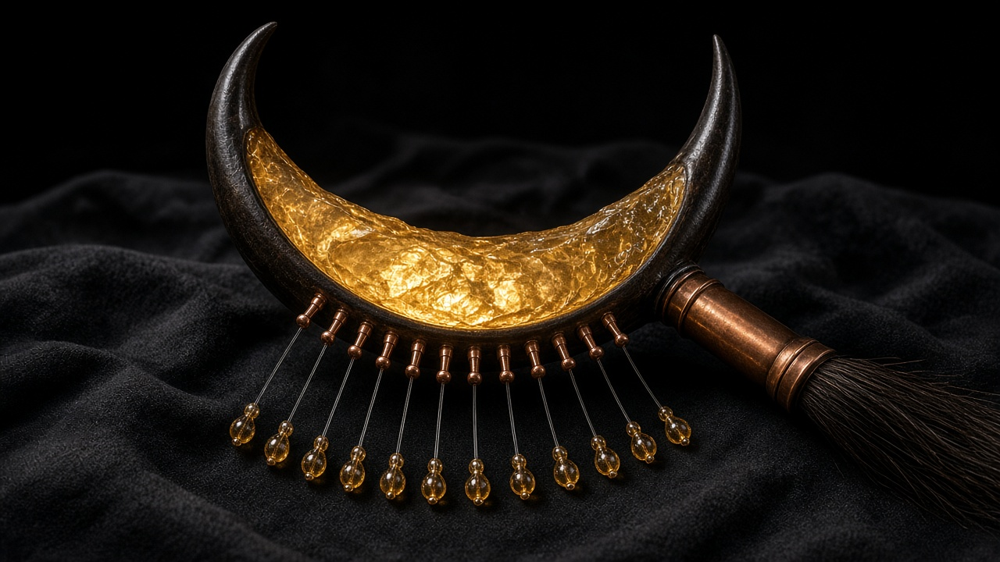
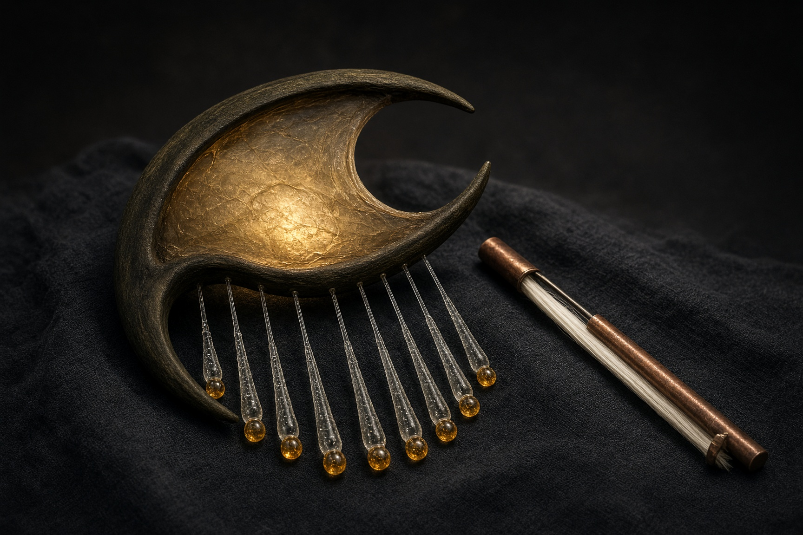

# La Filandria

Instrumento inventado: nueve hilos de vidrio, una membrana ahumada y una hendidura en madera de olivo. Se toca con un arco de crin guardado en cobre.

La escala de marea no es temperamento igual. Solo se pueden frotar estos nueve hilos:

| Nota | Hz |
|---|---|
| D3 | 146.15 |
| F3 | 173.35 |
| G3 | 194.55 |
| A3 | 217.70 |
| C4 | 258.20 |
| D4 | 291.55 |
| F4 | 345.85 |
| A4 | 434.05 |
| C5 | 514.55 |

D2 (73.08 Hz) y A2 (109.15 Hz) son el zumbido de la membrana. No son notas.

## Videos

| Archivo | Qué es |
|---|---|
| [filandria-marea-corta.mp4](filandria-marea-corta.mp4) | El instrumento, con la frase *Marea corta* |
| [filandria-la-mano.mp4](filandria-la-mano.mp4) | Alguien tocándolo. La frase es *La mano* (semilla 7) |
| [marea-corta.mp3](marea-corta.mp3) | Audio de *Marea corta* |
| [la-mano.mp3](la-mano.mp3) | Audio de *La mano* |

## Para otro bot

Todo el instrumento está en [`filandria.py`](filandria.py). Hace falta Python 3 y `numpy` (`pip install -r requirements.txt`).

Componer una frase nueva y grabarla:

```bash
python filandria.py compose --seconds 10 --seed 7 --title "La mano" --json la-mano.json --out la-mano.wav
```

La misma semilla produce la misma frase. Otra semilla, otra melodía.

Tocar una melodía ya escrita:

```bash
python filandria.py play marea-corta.json --out marea-corta.wav
```

Desde Python:

```python
import filandria

melody = filandria.compose(seconds=10, seed=21, title="Otra")
audio = filandria.render(melody)          # float64, forma (frames, 2), 48000 Hz
filandria.write_wav("otra.wav", audio)
```

Para imponer una melodía, pasa este objeto a `filandria.render` o a `play`:

```json
{
  "title": "La mano",
  "seconds": 10,
  "seed": 7,
  "events": [
    {"note": "A4", "start": 0.2, "bow": 0.6, "vel": 0.8}
  ]
}
```

- `note`: una de las nueve notas de la tabla.
- `start`: segundos desde el inicio. `>= 0` y menor que `seconds`.
- `bow`: segundos que el arco permanece en ese hilo. Entre 0.08 y 4.
- `vel`: fuerza del arco, entre 0.05 y 1.
- `seconds`: entre 4 y 60.
- `seed`: entero. Solo cambia el roce del arco; la misma semilla es la misma toma.
- `events`: de 1 a 64. El orden no importa.

Si el JSON no cumple el contrato, el programa termina con código 2 y escribe `error: ...` en stderr. No genera wav.

## Doce filamentos con clavijas de cobre (nuevo)



La Filandria tiene ahora **solo doce hilos de vidrio, uno por cada clase de altura** (C, C#, D, D#, E, F, F#, G, G#, A, A#, B). Cada hilo lleva una **clavija de tensión de cobre** que lo sube o baja de octava, así que los doce hilos cubren todos los semitonos de **F1 a F6**, afinados en temperamento igual con **A4 = 440 Hz**. El timbre es el mismo: mismo arco de crin, misma membrana ahumada, misma madera de olivo. Con la clavija en las octavas graves el hilo suena más oscuro y largo; en las agudas, más brillante.

El modo original de nueve hilos (escala de marea) sigue siendo el **predeterminado**: un JSON sin `"tuning"` suena exactamente igual que antes, bit a bit. La API y el sonido no cambian.



Para usar los doce hilos, añade `"tuning": "cromatica"` y escribe las notas con nombre (`"Bb4"`, `"A#4"`, `"Eb2"`, `"F1"`) o número MIDI (29–89):

```json
{
  "title": "Prueba", "tuning": "cromatica", "seconds": 8, "seed": 1,
  "gain": 0.5,
  "drone": [{"start": 0, "root": "Bb1", "fifth": "F2"}, {"start": 4, "root": "F1"}],
  "drone_level": 0.6,
  "events": [
    {"note": "F5", "start": 0.3, "bow": 0.7, "vel": 0.8},
    {"note": "Bb2", "start": 0.3, "bow": 3.5, "vel": 0.4, "breath": false}
  ]
}
```

Opciones nuevas (sirven en los dos modos):

- `drone`: `"fixed"` (predeterminado, el zumbido D2/A2 de siempre), `"off"` (membrana en silencio) o una lista de cambios `{"start", "root", "fifth"?}`. Con la lista, la membrana se retensa y sigue la armonía con un deslizamiento de unos 80 ms. Si no das `fifth`, se usa la quinta justa.
- `drone_level`: volumen de la membrana (1.0 por defecto, 0 la apaga).
- `gain`: escala los hilos frotados antes de la mezcla. Conviene bajarlo con muchas voces.
- `breath: false` en un evento: esa nota no mueve la capa de aire, así el aliento sigue a la melodía y no al bajo.

Ya **no hay límite de duración ni de número de eventos**, y el arco puede durar hasta 30 s. Si hay `scipy`, los filtros van mucho más rápido (con el mismo resultado). Sin `scipy` se usan los bucles originales.

## Himno Nacional Mexicano

- [`himno_mexicano/`](himno_mexicano/): v1, arreglo pentatónico aproximado en los nueve hilos.
- [`himno_mexicano/v2/`](himno_mexicano/v2/): v2, versión fiel en **si bemol mayor** con armonía y bajo, en los doce hilos con clavijas y en un solo render. WAV y MP4 están en el release `himno-mexicano-v2`.
